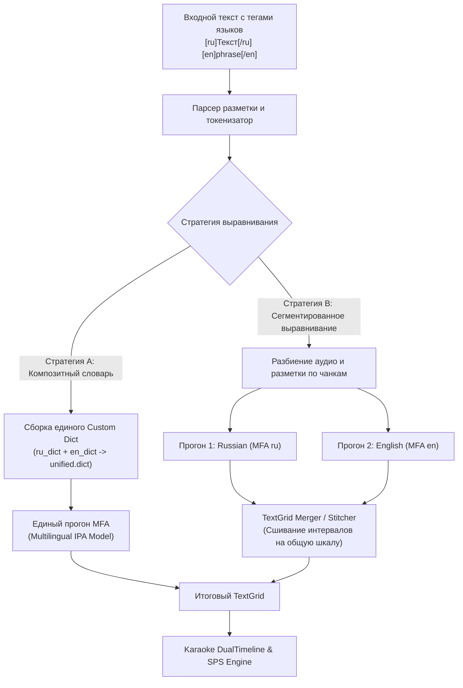
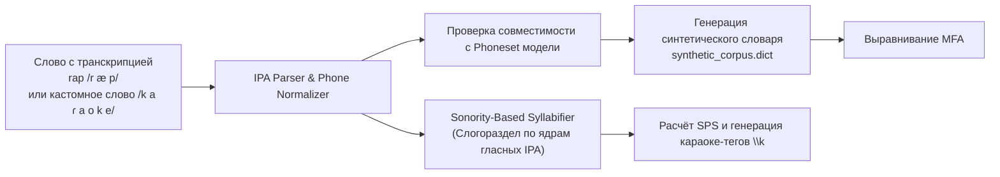

# Архитектурный план: Поддержка нескольких языков и прямого ввода IPA в MFA

> **Статус документа:** Архитектурный проект и дорожная карта (для будущей реализации).  
> **Проект:** Karaoke / SPS Workbench (`karaoke_pipeline`).  
> **Цель:** Обеспечить удобное выравнивание текста с чередованием языков в одном треке и возможность передачи готовой фонетической транскрипции IPA без привязки к словарям MFA.

---

## 1. Проблематика и цели

### 1.1. Текущие ограничения MFA
По умолчанию Montreal Forced Aligner (MFA) ориентирован на моноязычный корпус:
1. **Одна пара «модель + словарь» на выравнивание:** На один запуск команды `mfa align` передаётся единый словарь (`dictionary.txt`) и единая акустическая модель (`acoustic_model.zip`).
2. **Проблема OOV (Out-Of-Vocabulary):** Если в русскоязычном треке рэпер использует английские фразы или японские заимствования, русский словарь отмечает их как OOV (неизвестные слова) и выравнивание либо падает с ошибкой, либо игнорирует фрагменты.
3. **Отсутствие поддержки редких языков/диалектов:** Если для языка нет готового словаря или G2P-модели в репозитории MFA, выравнивание стандартным способом невозможно, даже если пользователь точно знает фонетический состав слов.

### 1.2. Цели разработки
1. **Multi-Language Alignment (Чередование языков в одном тексте):** Позволить размечать строки или фразы на разных языках (например, русский куплет с английским хуком или вкраплениями японского) и автоматически выравнивать их в рамках одной сессии.
2. **Direct IPA Ingestion (Прямой приём транскрипции IPA):** Позволить пользователю подавать фонетическую транскрипцию в формате Международного фонетического алфавита (IPA) напрямую, обходя словарный поиск и автогенерацию фонем.

---

## 2. Архитектура: Поддержка нескольких языков (Multi-Language)



### 2.1. Синтаксис разметки в тексте
Предлагается поддержать два взаимодополняющих режима:

1. **Явная разметка тегами (Explicit Inline Tags):**
   ```text
   [ru]Я делаю этот трек всю ночь,[/ru] [en]all night long,[/en]
   [ru]скорость растёт и замер показывает[/ru] [en]rap god mode.[/en]
   ```
   *Альтернативный компактный синтаксис:*
   `{ru: Я делаю этот трек} {en: all night long}`

2. **Автоматическая эвристика символьных диапазонов (Auto Unicode Heuristic Fast-Path):**
   - Если слово содержит исключительно кириллицу (`\u0400-\u04FF`) -> язык `ru`.
   - Если латиницу (`a-zA-Z`) -> язык `en`.
   - Если кандзи/кану (`\u3040-\u30FF`, `\u4E00-\u9FAF`) -> язык `ja` (обработка через SudachiPy).
   - Позволяет пользователю вообще не ставить теги для очевидных пар языков (например, русский + английский).

### 2.2. Стратегии реализации

#### Стратегия A: Композитный словарь (Unified Composite Dictionary) — *Рекомендуемый быстрый путь*
- **Суть:** Если используется многоязычная акустическая модель на базе IPA (например, `multilingual_ipa` от MFA), все фонемы словарей уже находятся в едином пространстве символов IPA.
- **Алгоритм:**
  1. Текст разбивается на токены. Для каждого токена определяется целевой язык.
  2. Из словаря языка А берутся транскрипции для слов А, из словаря языка Б — для слов Б.
  3. В папке `cache/` формируется временный файл `composite_pronunciation.dict`, содержащий объединение нужных словарных статей.
  4. MFA запускается **в один проход**, с полной сохранностью глобальных временных меток аудио.
- **Преимущества:** Высокая скорость (1 запуск MFA), отсутствие артефактов нарезки аудио.

#### Стратегия B: Сегментированное сшивание (Segmented Audio & TextGrid Merger)
- **Суть:** Применяется, если для разных языков требуются принципиально разные акустические модели (например, Kaldi-модель `russian_mfa` и `japanese_mfa`).
- **Алгоритм:**
  1. По паузам или предварительным границам (или грубому VAD) аудио размечается на языковые кластеры.
  2. Формируются изолированные корпуса для каждого языка.
  3. Запускаются независимые процессы `mfa align`.
  4. Разработанный модуль `TextGridMerger` производит конкатенацию интервалов с добавлением смещений времени (`offset_seconds`), собирая единый результирующий `merged.TextGrid`.

---

## 3. Архитектура: Прямой ввод IPA (Direct IPA Ingestion)



### 3.1. Синтаксис ввода IPA
Позволяет пользователю задавать транскрипцию прямо в тексте песни:

1. **Инлайн-нотация через слэши:**
   `слово/s l o v o/` или `quasar/ˈk w eɪ z ɑːr/`
2. **Явный маппинг в заголовке / сайдкаре (`.dict.custom`):**
   ```text
   # Файл project_pronunciations.txt
   skrrt  s k r t
   brrrap b r a p
   flexin f l ɛ k s ɪ n
   ```
3. **Режим чистого фонетического ввода (Raw IPA Stream):**
   - Для языков без письменности или экспериментальных треков текст может быть полностью представлен в виде цепочки фонем IPA, разделённых пробелами и символами границ слов (`#`).

### 3.2. Алгоритм синтетического словаря (Synthetic Dictionary Generator)
MFA Kaldi требует сопоставления «орфографическое слово -> список фонем».
1. **Нормализация IPA:**
   - Приведение символов к канонической форме Unicode (NFC).
   - Удаление или нормализация диакритик ударения (`ˈ`, `ˌ`), долготы (`ː`), если используемая акустическая модель обучена без них.
2. **Сверка фонем (Phoneset Validation):**
   - Модуль сверяет введённые фонемы с файлом `meta.json` или списком допустимых фонем целевой акустической модели MFA.
   - В случае несовпадения (например, редкий клик или нетипичный гласный) выдаётся предупреждение и автоматическая замена на ближайший эквивалент (IPA mapping table).
3. **Генерация `.dict` на лету:**
   - Создаётся синтетический словарь в каталоге `cache/synthetic.dict`, куда помещаются все пользовательские транскрипции.
   - При выравнивании этот словарь указывается как `--dictionary_path`.

### 3.3. Автоматический слогораздел из IPA для SPS
Большим преимуществом прямого ввода IPA является то, что слоговые ядра определяются однозначно по гласным фонемам IPA:
- Гласными ядрами признаются: `a, e, i, o, u, y, ə, ɪ, ʊ, æ, ʌ, ɒ, ɔ, ɛ, œ, ɯ, ɨ, ʉ, ɤ, ɐ`.
- Принцип возрастающей звучности (Sonority Sequencing Principle, SSP): граница слога проходит в точке минимальной звучности между двумя гласными ядрами.
- **Результат:** Точный подсчёт слогов для SPS и автоматическая генерация тегов караоке (`\kf<duration>`) даже для абсолютно неизвестных языков!

---

## 4. План реализации по этапам (Roadmap)

| Этап | Задача | Затрагиваемые модули | Результат |
| :--- | :--- | :--- | :--- |
| **Этап 1** | **Парсер разметки и Unicode-эвристика** | `karaoke_core/textprep.py` | Распознавание тегов `[lang]...[/lang]` и автоматическое разделение на токены по языкам. |
| **Этап 2** | **Генератор композитных словарей** | `karaoke_core/mfa.py`, `karaoke_core/alignment.py` | Автоматическое слияние словарных статей нескольких языков в один временный словарь для MFA. |
| **Этап 3** | **Парсер IPA и синтетический словарь** | `karaoke_core/ipa.py` *(новый модуль)* | Извлечение IPA из транскрипта, валидация по Phoneset и генерация `.dict`. |
| **Этап 4** | **IPA Слогоразделитель и интеграция в SPS** | `karaoke_core/syllables.py`, `karaoke_core/sps.py` | Подсчёт слогов и расчет SPS напрямую по фонемам IPA. |
| **Этап 5** | **Интерфейс в GUI (Alignment Panel)** | `karaoke_gui/alignment_panel.py` | Селектор нескольких языков (Multi-lang tagger) и переключатель режима прямого ввода IPA. |

---

## 5. Заключение

Предложенная архитектура:
1. Полностью сохраняет совместимость с существующим кодом и тестами `karaoke_pipeline`.
2. Позволяет наращивать функционал итеративно (начиная со Стратегии A и композитного словаря).
3. Решает ключевую проблему рэп-треков с мультиязычной лирикой и нестандартными словами/звуками без необходимости сложного дообучения акустических моделей MFA.
